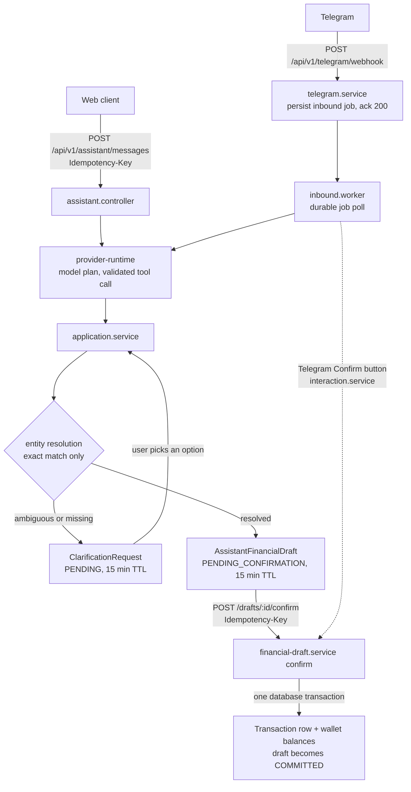

# Pocket Mint — Backend

[](https://github.com/acuyaldi/pocket-mint-backend/actions/workflows/ci.yml)

A personal finance API with an assistant that turns plain Indonesian messages ("beli kopi 25rb pakai GoPay") into transaction drafts. Nothing is written to your ledger until you explicitly confirm.

Express 5 + TypeScript + Prisma 7 on PostgreSQL. Frontend: [pocket-mint-frontend](https://github.com/acuyaldi/pocket-mint-frontend).

## Project status

- **Personal project, beta.** `main` holds release 0.6.0 (merged 2026-10-15). `dev` holds the next release (0.7.0), which has **not** been cut to `main` yet.
- **No production deployment is running right now.** The deploy target moved off Railway and the VPS setup is not decided yet ([release runbook §D](docs/release/release-runbook.md#d-deployment-target-vps-tbd)).
- **Telegram** is covered by integration tests (webhook, worker, callback buttons) but has **not** been run live end-to-end.
- The dev stability gate passed on 2026-10-21: 15 consecutive integration runs, each 314/314 ([runbook §H](docs/release/release-runbook.md#h-dev-gate-ditutup--2026-10-21-kriteria-dilonggarkan)). Dogfooding started the same day.

**Deliberately out of scope**

- **Financial advice.** The assistant only accepts allow-listed intents (`transaction.create`, `analytics.monthly-spending-summary`; [src/assistant/intent.ts](src/assistant/intent.ts)). The date anchor given to the model is explicitly limited to resolving relative dates ([src/assistant/provider-instruction.ts](src/assistant/provider-instruction.ts)).
- **Auto-creating transactions.** The model can only produce a draft. A separate, authenticated confirm call is the only thing that commits it.
- **Fuzzy wallet matching.** Wallet references resolve by exact or normalized-exact name/alias match only. Anything ambiguous becomes a clarification question ([src/assistant/entity-resolution/wallet-resolver.ts](src/assistant/entity-resolution/wallet-resolver.ts)).

## Features

- **Natural-language capture:** message → draft → (clarification if needed) → explicit confirm. Drafts can be edited at confirm time. Drafts and clarifications expire after 15 minutes.
- **Two-wallet transfers:** "transfer 50rb dari BCA ke GoPay" becomes a TRANSFER draft that previews both wallets. On confirm it writes one transaction row and both balance changes in a single database transaction.
- **Wallet aliases:** users can give a wallet extra names ("dompet harian"). The database enforces uniqueness per user, and an advisory lock prevents collisions between names and aliases.
- **Two channels, one pipeline:** Web and Telegram share the same draft/confirm code. Telegram adds durable inbound/outbound job queues and Confirm/Cancel buttons. Transfers are handed off to the web app.
- **Privacy-safe capture events:** draft and clarification lifecycle events are stored for quality metrics without message text, amounts, names or row ids.
- The core personal finance API: wallets, transactions, categories, budgets, saving goals, installments/bills, recurring transactions, notifications and analytics.

## Architecture



Telegram code (`src/telegram`, `src/channels`) handles only ingestion, durability and delivery. From `application.service` on, both channels run the same code.

| Path | Responsibility |
|---|---|
| `src/app.ts`, `src/server.ts` | Express wiring, `/health`, entrypoint, channel worker start/stop |
| `src/routes`, `src/controllers` | HTTP routers under `/api/v1` and request handlers |
| `src/services` | Core finance services (wallets, transactions, budgets, goals, installments, aliases, …) |
| `src/domain` | Pure logic: billing cycles, reporting time, balances, ops visibility/remediation, capture report |
| `src/assistant` | Assistant core: provider runtime, intents/tools, entity resolution, clarification, drafts, conversations, capture events |
| `src/channels` | Channel-agnostic durable inbound jobs, outbound deliveries, callback/link tokens, retention |
| `src/telegram` | Telegram webhook, client, command handling, reply/keyboard rendering |
| `src/http`, `src/middleware`, `src/middlewares` | Auth context (Supabase JWT), correlation ids, CORS, rate limiting, error envelope |
| `src/config` | Environment parsing (single source of truth for env vars) |
| `src/utils` | Logger, Prisma error translation, JWT verification, money math |
| `src/scripts` | Read-only ops CLIs (`opsVisibility`, `captureReport`, `reconcile`) and gated `opsRemediate` |
| `prisma/` | Schema and migrations |

## Engineering decisions

Short versions. Each one links to the document or PR that has the evidence.

**Idempotency at two levels.** Draft confirm *requires* an `Idempotency-Key`. Replaying the same key returns the original transaction and has no second financial effect. Reusing a key on another draft returns `409`. `POST /messages` and `/execute` accept an optional key: the first request claims it, a concurrent duplicate gets `409 ASSISTANT_REQUEST_IN_PROGRESS`, and a later retry replays the stored response. A client that lost its connection can check `GET /conversations/:id/recovery-state`, which reports any still-`RUNNING` turn, before resending. → [docs/api/assistant-conversations.md](docs/api/assistant-conversations.md)

**Explicit confirm, atomic writes.** Confirm takes a per-draft advisory lock and checks the draft status. It then creates the transaction (for a TRANSFER: both wallet balances) and moves the draft to `COMMITTED` with a guarded `updateMany`, all in one Prisma transaction. Editing a draft means passing overrides on the same confirm call, so edit and commit cannot drift apart. → [docs/audit/assistant-audit-phase-21-37.md](docs/audit/assistant-audit-phase-21-37.md)

**Global lock order: conversation first.** Any transaction that writes more than one Assistant row locks the conversation row (`SELECT … FOR NO KEY UPDATE`) before clarification, draft, turn or execution rows. Conversation delete uses the same order when it cascades. This was not a theoretical rule. A stress test runs 100 iterations per case, at 0 ms and 200 ms of injected server-side write latency, and counts `pg_stat_database.deadlocks`. Before the fix it reproduced real Postgres deadlocks (`40P01`): up to 14 per case for clarification select vs delete, and 23 for turn finalize vs delete. It also showed raw Prisma `P2003` (FK violation) and `P2025` (record not found) errors leaking as `500`s. After the fix, every case shows 0 × 500 and 0 deadlocks. → [docs/assistant-stuck-states.md § Phase 38.2](docs/assistant-stuck-states.md#phase-382--global-lock-order), [test/assistant/conversation-lock-order.integration.test.ts](test/assistant/conversation-lock-order.integration.test.ts), PR #121

**Explicit state machines with terminal states.** Drafts: `PENDING_CONFIRMATION → COMMITTED | CANCELLED | EXPIRED | FAILED`. Clarifications: `PENDING → CONSUMED | CANCELLED | STALE`. Each transition passes one allowlist guard, so a new enum value is rejected by default. `FAILED` is terminal and is never retried automatically. Expiry is lazy. Read paths report the *effective* status (past TTL = expired) without writing, so the UI never offers a dead draft. Conflicts carry a machine-readable `error.detail` (`EXPIRED`, `FAILED`, `CONVERSATION_ARCHIVED`, …). → [docs/assistant-stuck-states.md](docs/assistant-stuck-states.md)

**Prisma error translation in one place.** `withPrismaErrorTranslation` ([src/utils/prismaErrors.ts](src/utils/prismaErrors.ts)) maps races lost against a concurrent delete or update (`P2025`, `P2002`, `P2003`) to typed `404`/`409` responses instead of `500`. It is applied across the Assistant and the core finance services.

**Bounded confirm transaction, safe 503.** Confirm runs with an explicit budget (`CONFIRM_TRANSACTION_OPTIONS = { maxWait: 5000, timeout: 15000 }`), and its database round-trips were cut from 22 to 16. A Prisma transaction timeout (`P2028`) is rolled back and returned as `503 ASSISTANT_TRANSACTION_TIMEOUT`. The draft stays `PENDING_CONFIRMATION`, never `FAILED`, so retrying with the same `Idempotency-Key` commits exactly once. The frontend keeps the key across retries. → [release runbook](docs/release/release-runbook.md) (known risk 7, §G.4), PR #119

**Capture events without free-form content.** `assistant_capture_events` stores closed enums, a schema version, a phase marker and a `correlationKey`. The key is the SHA-256 of an existing draft, clarification or turn id. Message text, amounts, wallet/category names and user ids are never stored. To be precise, the key is a **pseudonym, not anonymous data**: anyone with database access can hash a known id and join it back. Events are written after the financial transaction commits and never block it. A unique constraint makes duplicate writes no-ops. Retention is 180 days. → [src/assistant/capture-events.ts](src/assistant/capture-events.ts)

**Debugging a flaky test from evidence.** Integration tests occasionally failed with random `404`/`401` responses or `socket hang up`. The first guess, a reused port, was wrong. The actual cause: `supertest(app)` listens on `::` (dual-stack), which does not conflict with another process already listening on `127.0.0.1:<same port>`, but supertest dials `127.0.0.1`. So a foreign local server (an editor helper) sometimes answered the request. A repro with no database hit the foreign server in 14 of 50 runs of 2,000 parallel requests, and 0 of 50 after binding test servers to `127.0.0.1` ([test/helpers/loopbackServer.ts](test/helpers/loopbackServer.ts)). Flake frequency went from 2/31 runs to 0/15. No timeouts or retries were added. → [runbook §H.4](docs/release/release-runbook.md#h4-known-flaky-tests), PRs #122, #123

## Tech stack

Node 22 · Express 5 · TypeScript 5 · Prisma 7 (`pg` driver adapter) · PostgreSQL (Supabase-hosted in development) · Supabase Auth (JWT verified with `jose`) · Google Gemini via `@google/genai` (optional; the assistant is off by default) · Telegram Bot API · Vitest + Supertest + `embedded-postgres` · GitHub Actions.

## Getting started

**Prerequisites:** Node 22.x, npm, and a PostgreSQL database you can migrate. Supabase Auth credentials are needed for authenticated requests.

```bash
npm ci
cp .env.example .env          # fill in values; names below
npx prisma migrate deploy     # applies pending migrations to DATABASE_URL
npm run dev                   # ts-node-dev on $PORT (default 5001)
curl localhost:5001/health
```

**After every pull, run `npx prisma migrate deploy` again.** `dev` regularly adds migrations, and the app does not migrate on startup (CI enforces this). Prisma reads `DATABASE_URL` (see [prisma.config.ts](prisma.config.ts)). If that URL is a transaction pooler, run the migration with a direct or session connection URL instead.

**Environment variables** (names only; the full annotated list is in [.env.example](.env.example), parsing is in [src/config](src/config)):

| Group | Variables |
|---|---|
| Required | `DATABASE_URL`, `CORS_ALLOWED_ORIGINS`, `NODE_ENV`, and exactly one of `SUPABASE_JWT_SECRET` / `SUPABASE_URL` |
| Server / DB (defaults exist) | `PORT`, `TRUST_PROXY`, `DB_POOL_MAX`, `DB_IDLE_TIMEOUT_MS`, `DB_CONNECTION_TIMEOUT_MS`, `REPORTING_TIMEZONE`, `SUPABASE_JWT_AUD`, `SUPABASE_JWT_ISSUER` |
| Rate limiting | `RATE_LIMIT_ENABLED`, `RATE_LIMIT_WINDOW_MS`, `RATE_LIMIT_MAX`, `RATE_LIMIT_MUTATION_MAX` |
| Assistant (off unless set) | `ASSISTANT_PROVIDER`, `ASSISTANT_MODEL`, `GEMINI_API_KEY`, `ASSISTANT_PROVIDER_TIMEOUT_MS` |
| Telegram (off unless set) | `TELEGRAM_ENABLED`, `TELEGRAM_BOT_TOKEN`, `TELEGRAM_WEBHOOK_SECRET`, `TELEGRAM_BOT_USERNAME` |
| Channel workers (not in `.env.example`; defaults exist) | `CHANNEL_WORKERS_ENABLED`, `CHANNEL_INBOUND_POLL_MS`, `CHANNEL_OUTBOUND_POLL_MS`, `CHANNEL_BATCH_SIZE`, `CHANNEL_LEASE_MS`, `CHANNEL_MAX_ATTEMPTS_INBOUND`, `CHANNEL_MAX_ATTEMPTS_OUTBOUND`, `CHANNEL_RETENTION_DAYS` |
| Tests | `TEST_DATABASE_URL` (optional, see below) |

## Running tests

```bash
npx tsc --noEmit             # typecheck
npm test                     # vitest run; DB-backed suites skip unless TEST_DATABASE_URL is set
npm run test:integration     # official integration runner
```

`npm run test:integration` ([scripts/run-integration-tests.mjs](scripts/run-integration-tests.mjs)) starts a throwaway `embedded-postgres` instance, runs `prisma migrate deploy` against it, runs the integration files, then deletes the instance. Docker is not needed. If you set `TEST_DATABASE_URL`, it reuses that database, but refuses Supabase/RDS hosts and a database named `postgres`. Details: [docs/database-testing.md](docs/database-testing.md).

Reference numbers at the 2026-10-21 gate: 1,705 unit tests; integration 26 files / 314 tests, 15/15 consecutive green runs ([runbook §H.3](docs/release/release-runbook.md#h3-hasil)). CI runs typecheck, migrations on a disposable Postgres 18, the full test suite and the build, and fails if the build changes tracked files ([.github/workflows/ci.yml](.github/workflows/ci.yml)).

## Further documentation

Some docs are written in Bahasa Indonesia (noted below).

- [docs/api/assistant-conversations.md](docs/api/assistant-conversations.md): Assistant HTTP contract (messages, drafts, clarifications, idempotency, recovery)
- [docs/assistant-stuck-states.md](docs/assistant-stuck-states.md): draft/clarification state machines, effective status, global lock order
- [docs/audit/assistant-audit-phase-21-37.md](docs/audit/assistant-audit-phase-21-37.md): read-only audit of Phases 21–37.1 (2026-10-17; some findings have since been fixed, see the runbook)
- [docs/release/release-runbook.md](docs/release/release-runbook.md): 0.7.0 release rehearsal, migration dry-run, rollback, known risks, dev gate results (Indonesian)
- [docs/CONTINUE.md](docs/CONTINUE.md): where the project was paused and how to pick it up
- [docs/database-testing.md](docs/database-testing.md): integration test database
- [docs/backup-restore-runbook.md](docs/backup-restore-runbook.md): `db:backup` / `db:restore` / `db:verify`
- [docs/observability-runbook.md](docs/observability-runbook.md), [docs/prisma-runtime-connection.md](docs/prisma-runtime-connection.md), [docs/prisma-migration-reconciliation.md](docs/prisma-migration-reconciliation.md)
- Service architecture notes: [wallet](docs/architecture-wallet-service.md), [transaction](docs/architecture-transaction-service.md), [installment](docs/architecture-installment-service.md), [dashboard](docs/architecture-dashboard-service.md), [HTTP boundary](docs/architecture-http-boundary.md)
- [docs/deployment-runbook.md](docs/deployment-runbook.md): **historical** (Railway, Sprint 3I). The current deploy plan is runbook §D.

## Known limitations

From the [release runbook](docs/release/release-runbook.md) (§3, §9, §H.4):

- **Open gaps from Phase 38.1:** there is no capture event for an expired or stale clarification (adding one needs a migration). A Telegram Confirm button cannot be pressed again after its conversation is archived and restored, so the user has to confirm from the web. Resending a message only works when the original message is on the loaded history page. (The "clarification select on an archived conversation" gap was closed in Phase 38.2.)
- **Confirm can hold locks for up to 15 seconds.** It holds the draft advisory lock and the conversation row lock for the whole transaction. Archive, restore or delete of the same conversation waits. This is fine when the app and the database are in the same region; across regions confirm becomes slow.
- **Residual from #113:** `/users/sync` returns a generic 409. However, a 409 vs 200 response still reveals that an email belongs to another account, for identities without an email claim. It requires a valid JWT and is rate-limited. This risk was accepted.
- **Documented flaky test:** a timeout in `recovery-state-http` (seen once, 0/15 at the gate, not reproduced; the endpoint is read-only).
- **No per-user feature flag.** The assistant and Telegram can only be switched on or off for everyone.
- **Single instance assumed.** The rate limiter is in-memory.
- **No cron.** Expiry is lazy, and retention for capture events and channel jobs only runs when new traffic arrives.

## License

No license file is included. Ask the author before reusing the code.
